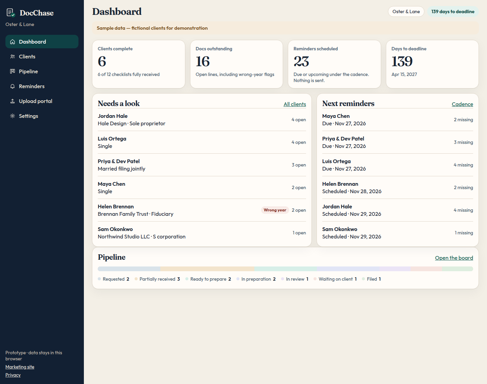

# DocChase

DocChase is a document autopilot for small accounting, bookkeeping, and tax-prep firms. It builds a checklist from last year's profile, reminds a client only about what is still missing, and stops when the file arrives.

## Pain point

Before and during tax season, a small firm loses days to document collection. The organizer is often the same long list for every client. Files show up by email, text, a portal, and the front desk. Someone sends reminders by hand, then answers the call asking whether the W-2 or the K-1 arrived. That work peaks in March and April, which is when preparers are already the scarce resource.

A practitioner account of the same busy-season pattern — generic checklists, documents in every channel, manual reminders, and status calls — is here: [Automate tax-season document collection](https://www.bechosenagency.com/insights/automate-tax-season-document-collection/).

## Target users

Accounting, bookkeeping, and tax-prep firms of about 1 to 30 people. The day-to-day user is the preparer, bookkeeper, or office manager who currently keeps the outstanding-document list in a spreadsheet and an inbox. DocChase covers the request, the chase, and the handoff into preparation. It does not prepare or file the return.

## Why it's fundable now

Firms are being funded for software that sits inside the practice and goes after missing paperwork, and the staffing math makes that operational work harder to cover with more people.

- On November 5, 2026, Kabilio raised a €10 million seed for an AI agent inside accounting firms that pulls invoices from client emails and chases missing paperwork. [Dealroom](https://dealroom.co/news/169824-kabilio-raises-10m-to-put-an-ai-agent-inside-accounting-firms/).
- On November 26, 2026, nextesy closed a $10.4 million seed for an AI business platform for SMEs and fiduciaries. The announcement reports 2,000+ customers. [Swisscom Ventures](https://ventures.swisscom.com/nextesy-closes-usd-10-4-million-seed-round-swisscom-ventures-leads-financing-of-zurich-ai-startup/).
- In the AICPA PCPS CPA Firm Top Issues Survey, almost all firm sizes listed finding qualified staffing as a leading concern. [AICPA & CIMA](https://www.aicpa-cima.com/resources/article/steps-to-small-firm-success-in-2026).
- In MarkosWeb's classification of the Y Combinator Fall 2026 batch, vertical AI agents are about 27.4% of the classified batch. [MarkosWeb](https://www.markosweb.com/startup-ideas/batch/f26).
- The practitioner write-up linked above is the operating picture those products are walking into: collection is still a manual loop of generic lists, scattered files, hand-sent reminders, and status calls.

DocChase is the narrower wedge inside that: the per-client checklist, the reminder that lists only the gap, and the pipeline from requested to filed, for a firm that is too small to staff a document desk.

## How to run

There is no build step and no server. Pages are static HTML, CSS, and JavaScript. State stays in `localStorage` in the browser.

**On this computer.** Open `index.html` from the repository root. The product prototype is `app/index.html`. Relative links also work from `file://`.

**On GitHub Pages,** from the repository root of `main`:

- Marketing site: https://shelly6243346.github.io/docchase/
- App: https://shelly6243346.github.io/docchase/app/

The app opens on a sample firm, Oster & Lane, with twelve fictional clients. A banner on every screen reads “Sample data — fictional clients for demonstration.” Settings includes **Reset demo data**, which restores that firm. The marketing waitlist (name, email, firm name, firm size) is stored separately in this browser and is not emailed anywhere. Prices on the site are marked “Hypothetical pricing for illustration.”

## Next steps

- Replace the rule-based file-name classifier with a model that reads the document, and keep a person in the loop when confidence is low or the tax year does not match.
- Deliver the reminder by email and text, with the same stop rule: nothing goes out once the checklist is complete.
- Give each client a real upload link that is not the staff application, and write status back to the portal or tax software the firm already uses.
- Review security, retention, and preparer access before any real client file is stored.
- Run one filing season with a handful of design partners in the 1–30 person range and keep the pipeline stages honest against how those offices actually work.
